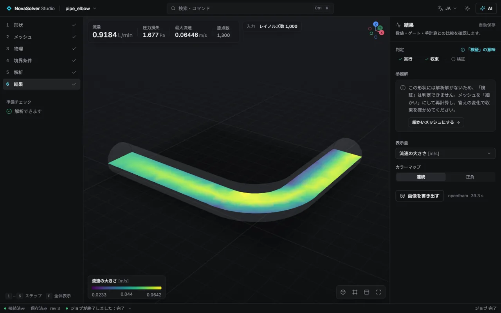
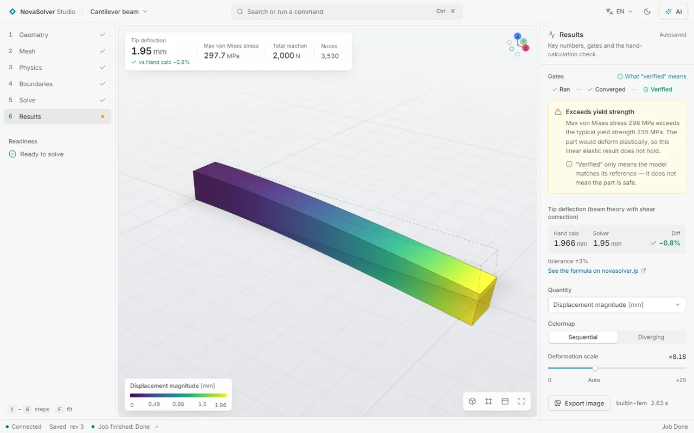

# NovaSolver Studio

**Free, local engineering simulation that your AI assistant can drive — and every answer is checked.**
Structural FEM, heat and CFD (CalculiX, OpenFOAM® and a built-in quadratic-tet solver) on your own PC, with an MCP
server so Claude or any MCP client can import your STEP/STL, set the loads, run, refine the mesh and verify the result.

[日本語](README.ja.md) · [中文](README.zh.md) ·
**[Try it in your browser (no install)](https://novasolver.jp/studio/demo/?lang=en)** ·
[Download for Windows](https://github.com/novasolver/novasolver-studio/releases/latest) ·
[novasolver.jp/studio](https://novasolver.jp/en/studio/)


*One sentence to the AI → Studio sets up and solves the case → mesh refined three times (GCI 1.5 %) → compared
with a hand calculation. Real app, real numbers.*

## Why Studio

- **Ran ≠ right.** Every result carries three separate gates: **ran → converged → verified**. Templates are checked
  against closed-form or literature answers, imported parts by an automatic mesh-convergence study (Roache GCI), and
  the AI is told never to call a result correct unless the verify gate passes. Warnings that matter (stress above
  yield, a stress singularity at a sharp corner) are passed on, not hidden.
- **Your models stay on your computer.** No account, no upload, no telemetry. The only network use is the optional
  update check and example download (offline mode turns those off), and a public test fails if any other code starts
  using the network. For confidential work with a cloud AI, **numbers-only mode** keeps even pictures of the part
  away from the AI. See [docs/PRIVACY.md](docs/PRIVACY.md).
- **Real solvers, no licence fee.** CalculiX for structural/thermal, OpenFOAM® for flow and water cooling, a built-in
  tet10 FEM for answers in seconds. Japanese, English and Chinese UI.
- **Typed MCP tools, no shell.** 30 tools (create/import, set conditions, mesh, run, convergence, verify, probe,
  sweep, render). The AI fills a case schema; Studio writes the solver input. Your AI's edits appear live in the
  window, and you can undo them.

| | |
|---|---|
|  |  |
| Pipe elbow, OpenFOAM® (pressure drop) | Cantilever vs beam theory |

## Checked against known answers

A sample of the references Studio compares itself with (the full validation suite with every case, tolerance and
mesh-convergence column is published with each release as `docs/VALIDATION.md`):

| Case | Reference | Studio |
|---|---|---|
| Cantilever tip deflection | Euler–Bernoulli + shear | −0.9 % (built-in tet10, also in the [browser demo](https://novasolver.jp/studio/demo/?lang=en)) |
| Cylinder on a flat block, contact pressure | Hertz line contact | −0.04 % (mortar contact, 0.7) |
| Sphere drag, external flow | Schiller–Naumann | +0.3 % (OpenFOAM®, snappyHexMesh + wall layers) |
| Water-cooled plate | heat balance | 0.03 % |
| Lid-driven cavity | Ghia et al. | profile match (built-in and OpenFOAM®) |

## What it does / できること

| Analysis | Geometry | Quick preview (built-in, seconds) | Final solve | Verification |
|---|---|---|---|---|
| Structural: linear static, modal, nonlinear (plasticity, large deformation) | templates · import STEP / IGES / BREP / STL | quadratic tetrahedral FEM | CalculiX | beam theory, Heywood Kt, mesh convergence (GCI) |
| Buckling, contact (mortar, tied), fatigue (Goodman, S-N) — 0.7 | templates · import | quadratic tetrahedral FEM | — | Euler columns, Hertz, Goodman |
| Thermal (steady conduction), thermal stress | templates · import | quadratic tetrahedral FEM | CalculiX | Fourier's law, fin theory, GCI |
| Electrostatics, DC current and Joule heating | templates · import | quadratic tetrahedral FEM | — | εA/d, 2πεL/ln(b/a), L/(σA) |
| Internal flow | templates · import | 2D cavity (built-in) | OpenFOAM® | Ghia (cavity), Poiseuille, mass balance |
| Flow around a body | import | — | OpenFOAM® (snappyHexMesh + wall layers) | sphere drag vs Schiller–Naumann (+0.3%) |
| Water cooling (conjugate heat transfer) | import (2+ bodies) | — | OpenFOAM® (chtMultiRegionSimpleFoam) | heat balance (0.03%) |

Also: a [Blender add-on](integrations/blender/) (send the active object to Studio, PLA/PETG/ABS/TPU or metals),
a [FreeCAD macro](integrations/freecad/) (send the selected part as STEP),
a 3D-print strength check (safety factor for each print direction in PLA/PETG/ABS, layer lines included), ParaView VTU / CSV / printable HTML report export, and a Windows installer with `.nscase`
file association.

## Install with Python (macOS / Linux / Windows)

After the first PyPI release, launch the GUI with `uvx novasolver-studio`, or install once with
`pipx install novasolver-studio` and run `novasolver-studio`. Python 3.10+ is required; Python 3.12 is tested in CI.
Older Python versions use compatible NumPy/SciPy/Matplotlib/WebSocket releases. The built-in FEM needs no external
solver. For an MCP client:

```json
{
  "mcpServers": {
    "novasolver-studio": {
      "command": "uvx",
      "args": ["novasolver-studio", "mcp"]
    }
  }
}
```

With pipx, use `"command": "novasolver-studio", "args": ["mcp"]` instead.
Cases go to `~/NovaSolverStudio/workspace` on macOS/Linux and `~/Documents/NovaSolverStudio/workspace` on Windows;
`NOVASTUDIO_WORKSPACE` overrides this. Source checkouts keep their `workspace/` folder.

| OS | CalculiX (optional structural/thermal solver) | OpenFOAM (optional CFD solver) |
|---|---|---|
| macOS | `brew install costerwi/calculix/calculix-ccx` | `brew install gerlero/openfoam/openfoam` (Apple Silicon, macOS 14+) |
| Linux | `sudo apt install calculix-ccx` or the distro package | Install ESI packages from [openfoam.com](https://www.openfoam.com/download/); detected under `/usr/lib/openfoam` or via `WM_PROJECT_DIR`. |
| Windows | Put `ccx_static.exe` in `solvers/calculix/` or set `NOVASTUDIO_CCX`. | ESI Windows MinGW build plus Microsoft MPI, as described below. |

On headless Linux, Gmsh needs `libglu1-mesa libgl1 libxrender1 libxcursor1 libxft2 libxinerama1`.
`NOVASTUDIO_CCX` and `NOVASTUDIO_OPENFOAM` can select an installation on every OS.
macOS OpenFOAM tools run through the app environment launcher; Linux tools source the installation's `etc/bashrc`.

## Quick start (developers) / 開発者向けの起動手順

```bash
python -m venv .venv
.venv\Scripts\python -m pip install "mcp>=2.3,<3" fastapi "uvicorn[standard]" numpy scipy matplotlib gmsh meshio psutil pyamg pymeshlab zstandard pytest
cd frontend && npm install && npm run build && cd ..
cd backend
set PYTHONPATH=%CD%
..\.venv\Scripts\python -m novastudio serve        # open http://127.0.0.1:8765
```

Solvers are found automatically when installed (without them, the built-in preview solvers still work):

- **CalculiX**: put `ccx_static.exe` under `solvers/calculix/` or set `NOVASTUDIO_CCX`.
- **OpenFOAM** (ESI Windows MinGW build): install to `%LOCALAPPDATA%\NovaSolverStudio\solvers\openfoam` (an ASCII-only
  path) or set `NOVASTUDIO_OPENFOAM`. Put Microsoft MPI's `msmpi.dll` in `%LOCALAPPDATA%\NovaSolverStudio\solvers\msmpi`.

## Use it from an AI assistant (MCP) / AI アシスタントから使う

**Easiest (Claude Desktop and other MCPB-aware apps):** download `novasolver-studio-<version>-win64.mcpb` from
[Releases](https://github.com/novasolver/novasolver-studio/releases) and open it — the app installs it as an extension.
Also listed in the [MCP Registry](https://registry.modelcontextprotocol.io/) as `io.github.novasolver/novasolver-studio`.

**With the downloaded zip:** point any MCP client at the exe.

```json
{
  "mcpServers": {
    "novasolver-studio": {
      "command": "C:\\path\\to\\NovaSolverStudio\\NovaSolverStudio.exe",
      "args": ["mcp"]
    }
  }
}
```

**From source:**

```json
{
  "mcpServers": {
    "novasolver-studio": {
      "command": "<studio>\\.venv\\Scripts\\python.exe",
      "args": ["-m", "novastudio", "mcp"],
      "env": { "PYTHONPATH": "<studio>\\backend" }
    }
  }
}
```

Then ask, for example: *"Import bracket.step, fix the bottom face, push 500 N on the top face, run it and tell me
whether the result is verified."*

## Electromagnetics (0.3) / 電磁気

The built-in tet10 solver now computes electrostatic potential, electric field and electrode charge, or DC current
with optional steady Joule heating. STEP assemblies can assign a dielectric or conductor to each body.
Three editable templates include analytic checks: **capacitor** against εA/d, **coax** against 2πεL/ln(b/a),
and **busbar** against L/(σA) and the temperature rise σΔV²/(8k) with both ends cooled.

内蔵 FEM で静電場・電流・ジュール発熱による温度を計算できます。平行平板コンデンサ・同軸ケーブル・銅母線の
3 テンプレートには解析解との比較があり、任意形状ではメッシュ収束を確認できます。

## Share face selection with an AI (0.4) / 選んだ面をAIと共有する

Select faces in the boundaries viewport, then ask “fix the faces I selected” or “put 500 N here”.
The assistant reads `get_gui_selection`, shows a numbered `render_view(quantity="faces", highlight=[...])`
to confirm the setup, and applies conditions through `update_case`. GUI and AI changes share one Undo/Redo
history. Ctrl+Z undoes the latest change by either of you; Ctrl+Shift+Z or Ctrl+Y redoes it.
Named face groups can be reused with `boundaries.@<group>.role` and other boundary fields.

画面で面を選んでから「選んだ面を固定して」のように頼めます。AIが選択内容を読み取り、面番号付きの画像で
確認してから条件を設定します。画面とAIの変更は共通の履歴に残り、どちらの変更も元に戻せます。
Hで選択した面を隠し、Alt+Hですべて表示。Ctrl+ドラッグで矩形選択、Xで透過表示を切り替えます。

在视图中选择面后，可以说“固定我选中的面”。AI会读取选择内容，用带面编号的图片确认设置，再应用边界条件。
界面与AI共用撤销和重做历史，双方的更改都可以撤销。面组可以保存并重复使用。

## Documentation

- Design: [`docs/DESIGN.md`](docs/DESIGN.md) · Roadmap: [`docs/ROADMAP.md`](docs/ROADMAP.md) · Development notes: [`docs/DEVELOPMENT.md`](docs/DEVELOPMENT.md)
- Tests: `python -m pytest backend/tests -q`

## License

GPL-3.0 — see [`LICENSE`](LICENSE). Programs called by Studio keep their own licenses — see
[`THIRD_PARTY_NOTICES.md`](THIRD_PARTY_NOTICES.md).

This offering is not approved or endorsed by OpenCFD Limited, producer and distributor of the OpenFOAM software via
www.openfoam.com, and owner of the OPENFOAM® and OpenCFD® trade marks.

Made by [NovaSolver](https://novasolver.jp) — interactive engineering simulators.
