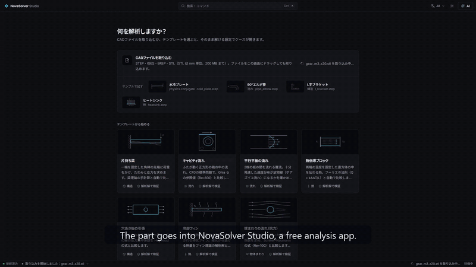

# NovaSolver Studio

**可交给 AI 助手操作的免费本地仿真软件，每个结果都经过理论解和网格收束检验。**
在您自己的电脑上求解结构（FEM）、传热和流动（CFD），使用 CalculiX、OpenFOAM® 和内置二次四面体求解器。
支持 MCP，Claude 等 AI 可以完成读取 STEP/STL、设置载荷、计算、加密网格到验证的全过程。

[English](README.md) · [日本語](README.ja.md) ·
**[在浏览器中试用（无需安装）](https://novasolver.jp/studio/demo/?lang=zh)** ·
[下载 Windows 版](https://github.com/novasolver/novasolver-studio/releases/latest) ·
[novasolver.jp/zh/studio](https://novasolver.jp/zh/studio/)（GitHub 访问不稳定时，安装包也可从该页面下载）

*对 AI 说一句话 → Studio 设置并求解 → 三次加密网格确认收敛（GCI 1.5%）→ 与手算比较。真实的软件，真实的数值。*

## 特点

- **“算出来”不等于“算对了”。** 每个结果分别给出“已运行 → 已收敛 → 已验证”三项判定。模板与解析解或文献值对比，
  导入的形状通过网格收敛研究（Roache GCI）自动检查。AI 被要求在验证通过之前不得称结果正确，并转达超过屈服、尖角应力奇异等警告。
- **模型不出本机。** 无账户、无上传、无遥测。仅有可选的更新检查和示例下载，离线模式下也会停止；若其他代码开始联网，公开测试会失败。
  与云端 AI 处理机密零件时，可用 **“仅数值模式”**，连零件图片也不交给 AI。→ [docs/PRIVACY.md](docs/PRIVACY.md)
- **免费使用正规求解器。** 结构和传热用 CalculiX，流动和水冷用 OpenFOAM®，内置 FEM 数秒出结果。界面支持中文、日文、英文。
- **29 个类型化的 MCP 工具，不执行 shell。** AI 只填写算例表，求解器输入由 Studio 生成；AI 的修改实时显示在界面中，可以撤销。

## 验证示例

| 算例 | 对比对象 | Studio |
|---|---|---|
| 悬臂梁端部挠度 | 梁理论（弯曲＋剪切） | −0.9% |
| 圆柱与平板接触压力 | Hertz 线接触 | −0.04%（0.7） |
| 球体阻力 | Schiller–Naumann | +0.3%（OpenFOAM®） |
| 水冷板 | 热平衡 | 0.03% |

完整的验证列表（含容差和网格收敛列）随每个版本以 `docs/VALIDATION.md` 发布。

## 功能

结构（线性静力、模态、塑性和大变形非线性、屈曲、接触、疲劳）、热传导与热应力、静电场、直流电流与焦耳热，
内部流动、外部流动、水冷（共轭传热）。可导入 STEP / IGES / BREP / STL。另有 [Blender 插件](integrations/blender/)、
3D 打印示例、ParaView VTU / CSV / 可打印 HTML 报告导出，以及带 `.nscase` 文件关联的安装程序。

安装与 MCP 客户端设置见 [README（英文）](README.md#use-it-from-an-ai-assistant-mcp--ai-アシスタントから使う)。

许可证：GPL-3.0。OpenFOAM® 是 OpenCFD Ltd. 的注册商标，本软件未经 OpenCFD 认可。
